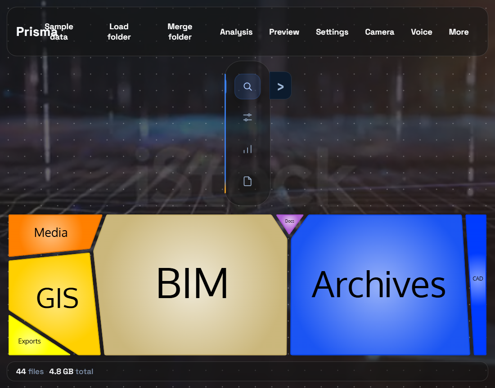
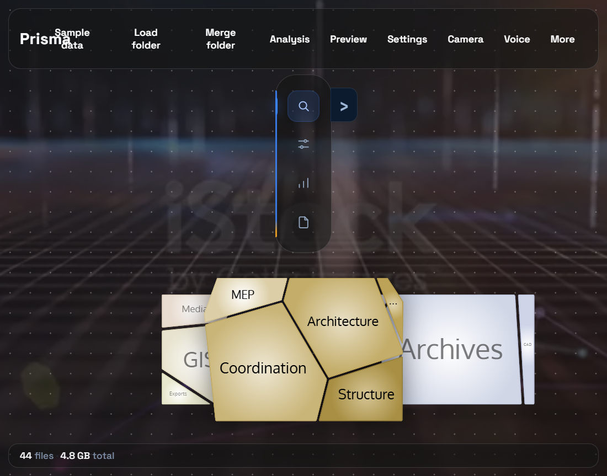
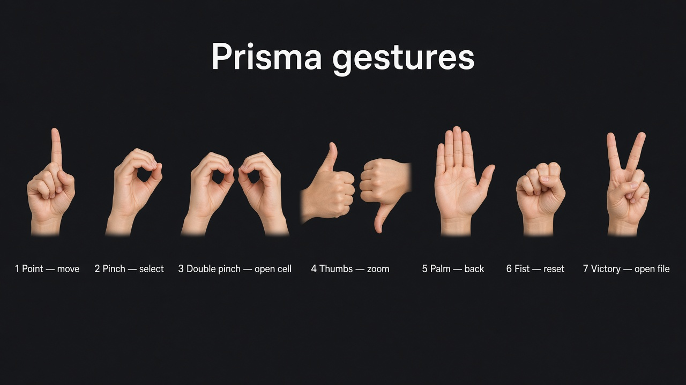
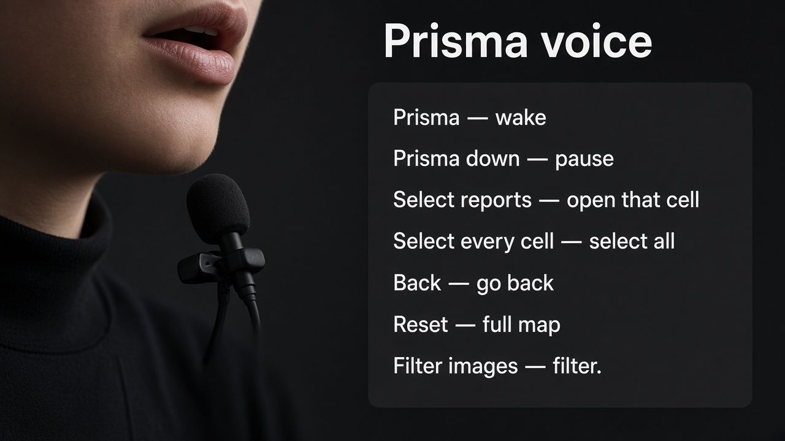

# Prisma

Visual filesystem analytics explorer. Scan a folder (or load a versioned JSON index) and inspect it with **Carrot Search FoamTree** — the official Voronoi treemap engine — plus search, filters, grouping, coloring, Analysis charts, file Preview, a FoamTree settings panel, and hand and voice control in Chrome.

Current product version: **0.4.0**.

The visualization uses the `@carrotsearch/foamtree` package (demo distribution). Prisma adapts the file index into FoamTree groups; it does not reimplement FoamTree’s layout. A Vite transform (`vite.foamtree-branding.ts`) strips the demo attribution cell so the stage stays clean.

## Capabilities (0.4)

| Area | What it does |
| --- | --- |
| **Scan / index** | Recursive folder scan, progress, versioned `.index.json`, sample Harbor-Bridge fixture |
| **Merge** | Merge folder or Merge JSON into the open map (multi-batch ACC / local trees) |
| **FoamTree** | Group / color / size / stack; factory defaults or Disk Prisma preset; live Settings |
| **Search & filters** | Query + extension / size / date filters in the Search sidebar section |
| **ACC** | Taxonomy group-by labels, Resolve ACC links, SharePoint browse (when configured) |
| **Analysis** | Folder-scoped bubble chart (age / subprogram / size) and line chart |
| **Preview** | PDF, IFC (3D), image, video, audio, text for the selected file |
| **Hands & voice** | Camera gestures and spoken commands (Chrome). See [Hands and voice](#hands-and-voice) |
| **Ask / API** | Natural-language Ask Prisma (multi-ask, dates, ACC metadata) + `window.prisma`. See [Ask Prisma](#ask-prisma) and the [semantic search & API manual](docs/readme/semantic-search-and-api.md) |
| **Export** | JSON index, CSV, workspace view state |

## Default look vs Disk Prisma

| Mode | Meaning |
| --- | --- |
| **Default** | FoamTree factory styling from the [settings demo](https://get.carrotsearch.com/foamtree/latest/demos/settings.html): rainbow colors, gradient fills, hierarchical stacking, Oxygen labels, light stage |
| **Disk Prisma preset** | Previous Prisma chrome/style from `context/file-treemap-explorer.html`: flattened stacking, plain fills, Inter labels, extension-based file coloring, dark stage |

Apply **Disk Prisma** from Settings → Presets → Appearance (or the Disk Prisma analysis preset under More).

## Architecture

```text
src/
  scanner/         filesystem traversal
  data/            schema, aggregation, JSON index
  metadata/        classification, ACC taxonomy, metadata providers
  acc/             ACC auth, link resolve, saved attribute sheets
  sharepoint/      Graph auth + drive import
  visualization/   grouping, color/size mappers, FoamTree adapter
    foamtree/      dataObject, options, settingsSchema, stylePresets, host
  filtering/       composable filters
  search/          query parser + fuzzy search
  config/          defaults, analysis presets, workspaces
  gestures/        camera hand control
  voice/           speech commands
  api/             window.prisma bridge (ask, search, select)
  search/          field search + natural-language intent
  ui/              shell, sidebar rail, Analysis, Preview, Settings, dialogs
  utils/           previewKind, pdf, ifc, ACC / web links
```

The JSON index is a first-class artifact. Visualization never requires a live rescan.

## Prerequisites

- Node.js 20+
- Chrome or Edge for folder scanning (File System Access API)
- Chrome for **Camera** and **Voice** (MediaPipe hand tracking and the Web Speech API)

## Install

```bash
npm install
```

## Development

```bash
npm run dev
```

Open the printed local URL. Then:

1. **Load folder** — recursive scan with progress; export as `<root>.index.json`.
2. **Merge folder** — add another ACC or local batch into the current map.
3. **Open JSON** / **Merge JSON** (More) — load or merge a previously exported index.
4. **Sample data** — Harbor-Bridge fixture for UI review without a local tree.
5. **Analysis** — charts for the open / focused folder scope.
6. **Preview** — inspect the selected PDF, IFC, or media file.
7. **Settings** — FoamTree options, color/style presets, export settings JSON.
8. **Camera** / **Voice** — drive the map with a hand or by speaking. Chrome only.

## Sample map

**Sample data** loads the Harbor-Bridge fixture (44 files, about 4.8 GB of stand-in sizes) so the map can be reviewed without scanning a disk.



Opening the BIM cell — double-click it, pinch twice with the camera, or say **Select BIM** — zooms into that folder:



## Hands and voice

Use Chrome. **Camera** asks for the webcam. **Voice** asks for the microphone and starts with commands on. Say **Prisma down** to pause speech, and **Prisma** to resume it.



| Gesture | How | Result |
| --- | --- | --- |
| Point | Move the index finger | The cursor follows the hand |
| Pinch | Touch thumb and index, then release | Select the cell under the cursor |
| Double pinch | Pinch twice | Zoom into that cell |
| Thumbs up / down | Hold | Zoom in / zoom out |
| Open palm | Hold | Go back one level |
| Fist | Hold | Reset to the full map |
| Victory | Hold index and middle up | Open the file under the cursor |



| Say | Result |
| --- | --- |
| **Prisma** | Resume commands after **Prisma down** |
| **Prisma down** | Pause commands. The microphone stays on |
| **Select BIM** | Open that cell, the same as a double-click. A folder zooms open; a file opens |
| **Select every cell** | Select every cell in the current view |
| **Ask …** / **Find …** / full NL ask | Run Ask Prisma semantic search on the map |
| **Back** | Leave Ask Prisma (restore prior map) or go up one level |
| **Reset** | Clear Ask Prisma and return to the full map |
| **Filter images**, **Filter pdf**, **Filter rvt** | Filter by category, type, or extension |
| **Clear filters** | Clear the filter and the search |

A phrase can include the wake word, for example **Prisma back**. The bottom-left card quotes what was heard and names the result (`Opened BIM`, `Back`, `View reset`).

## Ask Prisma

The Search sidebar includes **Ask Prisma**: natural language over the loaded JSON index (name, path, extension, dates, counts, and JSON/ACC metadata). Hits are pinned as adjacent FoamTree cells. Esc / Backspace restores the prior map.

Examples:

```text
all revit models for airfield location for last month
3 newer revit / last month pdfs / two weeks ago dwg
Architectural revit models
electrical revit models
ACC-Discipline=ELE7
```

Voice: **ask …**, **find …**, or a full ask sentence. Mic / **Speak to map** dictate into the Ask box.

Full phrase cookbook, metadata fields, map behavior, and API reference: **[Semantic search & API manual](docs/readme/semantic-search-and-api.md)**.

### `window.prisma` API

After the app loads in Chrome, `window.prisma` drives the explorer (map, Ask Prisma, filters, panels, load/export, camera, voice).

```js
prisma.loadSample()

// Map: click, open (double-click), back, reset
prisma.click("BIM")
prisma.doubleClick("Architecture")
prisma.open("Airfield-Terminal.rvt")
prisma.back()
prisma.reset()
prisma.selectAll()

// Ask Prisma (semantic)
prisma.ask("3 newer revit / last month pdfs")
prisma.askMany(["electrical revit models", "drawings runway 05"])
prisma.parseAsk("Architectural revit models")
prisma.getAsk()
prisma.clearAsk()

// Classic search + filters
prisma.search("ext:rvt Architecture")
prisma.filterExtension("rvt")
prisma.clearFilters()

// Panels
prisma.showPreview()
prisma.showAnalysis()
prisma.showSettings()
```

| Area | Methods |
| --- | --- |
| **State** | `getIndex`, `getState`, `subscribe`, `getSelected`, `getHovered`, `listFiles`, `listVisible`, `findFile` |
| **Load / export** | `loadSample`, `loadIndex`, `openFolder`, `openJson`, `mergeFolder`, `mergeJson`, `exportJson`, `exportCsv`, `exportWorkspace`, `cancelScan` |
| **Search** | `search`, `clearSearch` |
| **Ask Prisma** | `ask`, `askMany`, `previewAsk`, `parseAsk`, `splitAsk`, `getFavorite`, `getAsk`, `listAskHits`, `clearAsk`, `pinAskHits` |
| **Filters** | `filterCategory`, `filterExtension`, `filterCategories`, `filterByQuery`, `setFilters`, `patchFilters`, `clearFilters`, `emptyFilters` |
| **Map / cells** | `click`, `select`, `selectByName`, `selectAll`, `open`, `openSelected`, `doubleClick`, `hover`, `back`, `reset`, `drillInto`, `setFocusPath`, `zoomIn`, `zoomOut`, `getFoamTree` |
| **Panels** | `showFilters`, `hideFilters`, `toggleFilters`, `showPreview`, `hidePreview`, `showAnalysis`, `hideAnalysis`, `showSettings`, `hideSettings`, `showCommands`, `setPanel` |
| **View** | `setTheme`, `setGroupBy`, `setColorBy`, `patchVisualization`, `patchStyle`, `applyPreset`, `applyStylePreset`, `resetVisualization` |
| **Camera / voice** | `startCamera`, `stopCamera`, `toggleCamera`, `cameraStatus`, `startVoice`, `stopVoice`, `toggleVoice`, `voiceStatus` |
| **ACC / SharePoint** | `resolveAccLinks`, `signInAcc`, `signOutAcc`, `openSharePointBrowser` |

See also the [semantic search & API manual](docs/readme/semantic-search-and-api.md).

## Build

```bash
npm run build
npm run preview
```

## Scanning

- Permission errors and locked files are recorded in `errors` and do not abort the scan.
- Cryptographic hashing is not performed.
- Browser scans cannot observe created/accessed times, NTFS attributes, or symlink identity; those fields stay `null` rather than guessed.
- Specialized metadata (for example image pixel size) is only stored when a provider actually extracts it.

## JSON index

Schema version `1.0`. Shape:

```json
{
  "schemaVersion": "1.0",
  "generatedAt": "",
  "generatorVersion": "0.1.0",
  "root": { "id": "/", "name": "", "path": "" },
  "statistics": {},
  "items": [],
  "errors": []
}
```

Load this file later with **Open JSON**. Workspaces (`prisma.workspace.json`) store view state only — not a second copy of file metadata.

## UI layout

```text
Top bar (Prisma + path, then commands)
  → [ sidebar rail + one section | FoamTree, Analysis, Preview, or Settings ]
  → status bar
```

The map sits on a looping backdrop. Space between cells stays clear, and the cell under the pointer gets a blue edge. The path (`all files › BIM › …`) is in the top bar beside the Prisma name, not on its own row.

**Camera** opens a card at the bottom-right. **Voice** opens a card at the bottom-left.

### Top bar

Sample data · Load folder · Merge folder · Analysis · Preview · Settings · Camera · Voice · More

**More** closes after any submenu action (Open/Merge JSON, SharePoint, ACC links, exports, presets, theme, commands).

### Left sidebar

The icon rail stays up. Each icon shows **only** its panel:

| Icon | Panel |
| --- | --- |
| Search | Search box + Filters |
| Structure | Group by, hierarchy, color by, display stacking |
| Overview | Scope totals and top types |
| File Identity | Selection details |

## Configuration

- **Structure panel:** Group By (including ACC taxonomy levels), Color By, Multi-Level Hierarchy, Display (flattened / hierarchical)
- **Settings panel:** FoamTree options with live updates; Presets (Appearance, Color, Borders & fill, Layout, Animation); export settings JSON
- **Analysis presets (More):** Disk Prisma, BIM, CAD, Large Files, Recently Modified, Engineering, Archive

## Search

Examples:

```text
bridge
ext:dwg
category:BIM
size:>100MB
modified:>2026-01-01
name:harbor AND path:BIM
```

## Keyboard

| Shortcut | Action |
| --- | --- |
| Ctrl+O | Open folder |
| Ctrl+Shift+O | Open JSON |
| Ctrl+F | Focus search (opens sidebar if hidden) |
| Ctrl+K | Command palette |
| Ctrl+R | Rescan / open folder |
| Esc | Close overlay / leave Ask Prisma (restore prior map) / clear selection / navigate up |
| Backspace | Leave Ask Prisma (restore prior map) / navigate back |

Ask Prisma details: [semantic search & API manual](docs/readme/semantic-search-and-api.md).
| Enter | Open selected file |

## Tests

```bash
npm test
npm run typecheck
```

## Agent docs

Cursor implementation prompts live in `.cursor/rules/` (overview, architecture, visualization, UI, workflow, commands, acceptance). Keep them in sync when capabilities change — see `18-git-and-documentation.md`.

## Troubleshooting

- **Open folder disabled / error** — use Chromium (Chrome, Edge, or a Chromium-based Electron shell). Firefox does not implement `showDirectoryPicker`.
- **Malformed JSON** — Prisma reports validation errors and does not crash.
- **Empty visualization after filters** — clear all filters or widen the query; the status bar shows matching counts.
- **Want the old Disk Prisma look** — Settings → Presets → Appearance → Disk Prisma.
- **FoamTree logo still visible** — hard-refresh; branding strip runs via Vite on `@carrotsearch/foamtree`.
- **Camera or Voice does nothing** — use Chrome, allow the camera or microphone in the address bar, and refresh. Voice starts in **Commands on**. **Prisma down** pauses it. Say **ask** (or a full Ask Prisma sentence, e.g. “all revit models for airfield location for last month”) to run semantic search on the map.
- **Hand pose is recognized but the map does not move** — point at a cell first. Pinch selects, a second pinch zooms in, an open palm goes back, and a fist resets.
